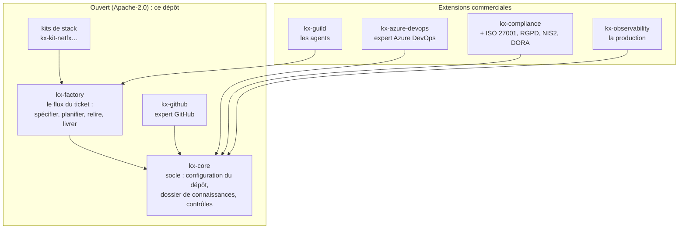

# Du ticket au déploiement : les agents exécutent, l'humain décide

Présentation de l'usine logicielle agentique **kx** : un cycle de développement complet (AI SDLC), où des agents d'IA spécifient, codent, testent et relisent, et où des humains décident à chaque étape qui engage.

**[Voir la présentation](https://claude.ai/artifact/B17VFZP4wZzMkkPs65kJGr)** · 27 diapositives · en français

> La présentation vit sur claude.ai : elle évolue sans réexport. Si le lien ne s'ouvre pas pour vous, demandez l'accès à cdanilov@kymexia.fr.

## Pour qui

Les équipes de développement, du solo-entrepreneur à la petite équipe de 3 à 5 personnes, et leurs partenaires : PO, lead devs, développeurs, responsables qualité et sécurité.

## Ce qu'elle couvre

1. **Le contexte** : le métier de développeur change, et une règle tient l'ensemble. Auteur, relecteur et approbateur sont toujours distincts ; seul un humain approuve, livre et déploie.
2. **Qui fait quoi** : les humains, les agents, et la pipeline qui contrôle sans IA.
3. **Un vrai ticket, de bout en bout** : d'où vient le besoin, les critères écrits avant le code, le plan, l'implémentation, les contrôles automatiques, la relecture, la livraison et le déploiement.
4. **Les points clés** : le savoir du projet versionné dans le dépôt, les critères d'acceptation, la conformité (ISO 27001, RGPD, NIS2, DORA), l'indépendance des outils, et autant d'étapes que le ticket le mérite.
5. **Pourquoi ça marche** : les mécanismes, la place de kx parmi les autres outils, ce qu'on mesure, l'amélioration continue du harnais et la sobriété.
6. **Pour qui, et la preuve par l'usage** : l'organisation en petites équipes, les bénéfices, et un plugin construit avec ses propres skills.

## Le marketplace en un coup d'œil

Un **marketplace** Claude Code est un catalogue de plugins qu'on ajoute une fois, puis dont on installe les plugins utiles. Celui-ci s'appelle `kymexia`. Chaque plugin a un rôle étroit et s'appuie sur le socle.



Une flèche signifie « s'appuie sur ».

- **`kx-core`, le socle.** Il lit la configuration du dépôt cible et son dossier de connaissances, et fournit les scripts de contrôle communs. Il ne contient rien de propre à un projet.
- **`kx-factory`, le flux du ticket.** Les gestes du cycle complet, de la spécification à la livraison, avec des portes automatiques et une approbation toujours humaine.
- **Les experts** traduisent les opérations communes (lire un ticket, ouvrir une PR) pour chaque forge : GitHub d'abord, puis Azure DevOps, puis GitLab. Le reste de l'usine ne change pas d'une forge à l'autre.
- **Les kits de stack** apportent les commandes, les règles de relecture et les modèles d'une technologie : .NET Framework d'abord.
- **Les extensions commerciales** ajoutent les agents autonomes, la preuve de conformité et le suivi de la production. Elles ne sont pas dans ce dépôt.

Pour commencer :

```bash
claude plugin marketplace add costeldanilov/kx-marketplace
claude plugin install kx-core@kymexia
claude plugin install kx-factory@kymexia
```

## Pour aller plus loin

- [Spécification des plugins ouverts](../fr/specification.md)
- [Configurer un dépôt GitHub et son Project](../fr/configuration-depot-github.md)
- [Le dépôt du marketplace](https://github.com/costeldanilov/kx-marketplace)
